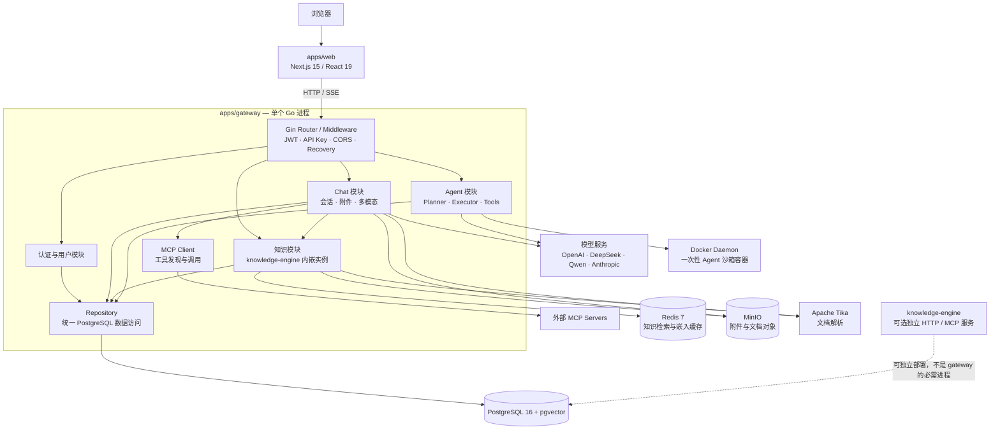
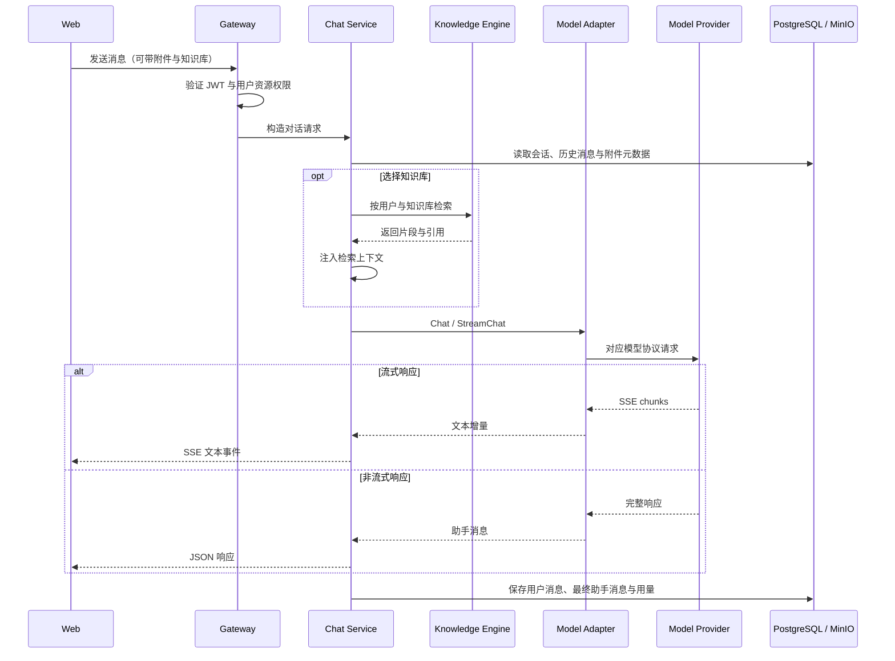
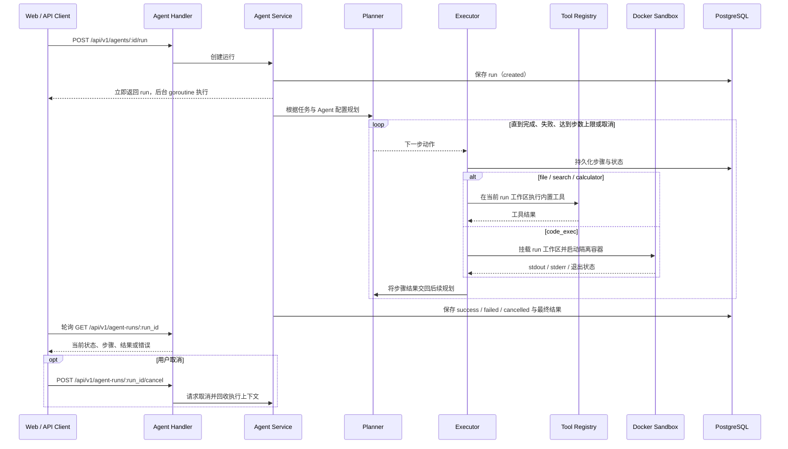

# OmniDev — 系统架构

## 1. 架构原则

当前系统是面向团队的 AI 知识与编码工作台，只保留三条产品主线：Chat、知识库、后台 Agent。

- **模块化单体**：认证、用户、Chat、知识库和 Agent 均运行在 `apps/gateway` 的同一个 Go 进程中，通过包边界而不是网络拆分模块。
- **复用知识引擎**：gateway 直接 import 兄弟仓库 `knowledge-engine`，不维护第二份 RAG 实现；该引擎也可独立提供 HTTP API 和 MCP server。
- **按真实依赖部署**：只需要 PostgreSQL + pgvector、Redis、MinIO、Tika 和 Docker。Kafka、Elasticsearch、Temporal、Kubernetes、Helm、Terraform 均不属于当前架构。
- **隔离不可信代码**：Agent 代码只在 Docker 沙箱中执行，没有宿主机直接执行的后备路径。
- **文档与代码一致**：在线 IDE、拖拽工作流、支付、部署托管和监控全家桶已经移除；Agent 自动提交 PR 仍是规划项。

## 2. 运行拓扑

`knowledge-engine` 是编译进 gateway 的 Go 依赖，不是 gateway 必须访问的微服务。只有需要把它提供给其他客户端时，才单独启动它的 HTTP/MCP 入口。

## 3. 后端模块边界

| 包 | 职责 | 不负责 |
|---|---|---|
| `internal/router`、`internal/handler` | 路由、HTTP 参数与响应、SSE、JWT 保护 | 业务规则与数据库细节 |
| `internal/service` | 认证、用户、会话、消息和模型配置等业务流程 | Agent 内部执行状态机 |
| `internal/adapter` | 不同模型协议的请求、响应和流式解析 | 跨供应商的伪统一能力承诺 |
| `internal/knowledge` | 把知识引擎 Handler 接入 gateway 路由 | 复制 RAG 存储与检索实现 |
| `internal/mcp` | Streamable HTTP MCP 初始化、工具列表、工具调用与命名冲突处理 | MCP server 管理后台 |
| `internal/agent` | Agent 配置、异步运行、规划、步骤、工具、取消与沙箱 | Git 操作、自动 PR、长期工作流 |
| `internal/repository` | gateway 业务表的数据访问 | 跨服务 RPC |
| `packages/go-common` | 配置、日志、数据库、缓存、认证、存储、解析等共享能力 | 消息总线或工作流引擎 |

模块间以 Go 接口和结构体交互。当前没有 gRPC、服务发现、分布式事件总线或独立 worker 集群。

## 4. Chat 请求链路

### 4.1 普通对话与知识增强

### 4.2 外部 MCP 工具调用

启用 `MCP_ENABLED` 后，gateway 在启动时连接配置中的 MCP server 并获取工具列表。Chat 在模型支持工具调用时进入最多 5 轮的“模型 → 工具 → 模型”循环，工具结果截断到 8000 字符，最终把工具名记录到助手消息的 `tools_used` 元数据。

当前 OpenAI、DeepSeek、Qwen 适配器支持该链路。Anthropic 普通对话可用，但 `tool_use` / `tool_result` 尚未映射，因此不会向 Anthropic 请求宣告 MCP 工具。MCP server 暂时不可用时记录警告，不阻止 gateway 启动。

## 5. Agent 异步执行链路

运行记录和步骤存 PostgreSQL；每个 run 使用独立工作区。当前异步队列是进程内 goroutine，不是持久化分布式任务队列，因此不能把进程重启后的任务恢复描述为已实现能力。

## 6. Docker 沙箱边界

`code_exec` 为每次执行创建一次性容器：

- 仅把当前 run 的工作区绑定到 `/workspace`，文件工具也限制在对应工作区内。
- 默认关闭网络，根文件系统只读，`/tmp` 使用 tmpfs。
- 丢弃全部 Linux capabilities，启用 `no-new-privileges`。
- 限制 CPU、内存、PID 数、执行超时和输出大小；默认超时 120 秒，输出最多保留 1 MiB。
- 执行结束或取消后强制清理容器。

当 gateway 自身运行在容器中时，Docker daemon 看到的是宿主机路径。`SANDBOX_WORKSPACE_ROOT` 表示 gateway 容器内路径，`SANDBOX_HOST_WORKSPACE_ROOT` 表示同一目录在宿主机上的路径；二者不能混用。Compose 通过挂载 Docker socket 和宿主机工作区支持这一模式。

挂载 Docker socket 等价于授予 gateway 较高的宿主机权限，只应在可信、受控的部署环境使用。当前隔离基于普通 Docker 容器，不宣称已经提供 gVisor、Seccomp 定制配置或多租户强隔离保证。

## 7. 数据与外部依赖

| 依赖 | 当前用途 |
|---|---|
| PostgreSQL 16 | 用户、认证、模型配置、会话、消息、附件、Agent、运行与步骤 |
| pgvector | knowledge-engine 的文档向量与相似度检索，维度随 embedding 配置 |
| Redis 7 | knowledge-engine 的检索与嵌入缓存 |
| MinIO | Chat 附件和知识文档对象 |
| Apache Tika | 附件与知识文档文本解析 |
| Docker | Agent `code_exec` 沙箱 |
| 外部模型 API | Chat 与 Agent 推理、知识 embedding |
| 外部 MCP server | 可选的 Chat 工具扩展 |

数据库迁移集中在 `apps/gateway/migrations`，按 `001` 至 `009` 顺序执行，所有业务模块共享一个数据库 schema。

## 8. 部署形态

开发环境使用两份 Compose 文件：

- `docker-compose.infra.yml`：PostgreSQL/pgvector、Redis、MinIO、Tika 和一次性 migration 容器。
- `docker-compose.dev.yml`：gateway 与 nginx；按需覆盖基础设施文件共同启动。

前端可在宿主机用 Next.js 开发服务器运行，后端可用 `go run` 或容器运行。staging CD 当前只构建并推送 gateway 镜像，不包含虚构的 Helm 自动部署；实际发布按 Compose 步骤执行。

当前未提供生产级高可用、自动扩缩容、备份恢复、SLA 或完整可观测性平台。这些必须通过后续运维设计与验证单独交付，不能从开发 Compose 推导为既有能力。
